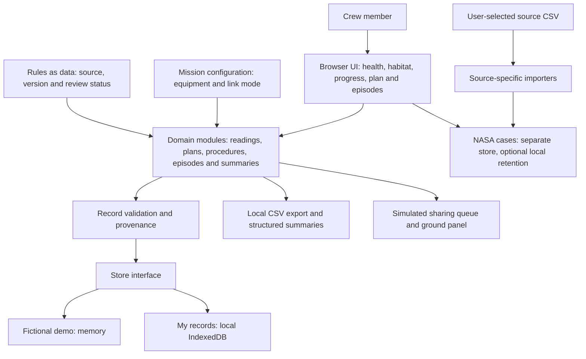

# Órbita — Your health, on board

**From “I feel different” to a documented next step, with the equipment available on your mission.**

Developed by **Team Astra Vitae · Argentina**.

NASA Space Apps Challenge 2026 · [Create Health Monitoring Software for Astronauts on Space Missions](https://www.spaceappschallenge.org/2026/challenges/health-monitoring-software/) · [Technical README](docs/TECHNICAL_README.md) · [Sources and licenses](docs/RESOURCES_USED.md)

**Live demo: [Open Órbita on Vercel](https://hackathon-nasa-orbita.vercel.app/#/adaptation)** — try the application in your browser without installing anything. Start with **Synthetic demo (fictional)** to explore the project without entering personal data.

## Summary

Órbita is a browser-based visual health tool developed for astronauts to connect what they feel, what has been measured and what they can do with the equipment available on their mission. It brings together health indicators, physical assessments, environmental readings, guided procedures and personal follow-up. A crew member can report a symptom, review available information and gaps, record an action and its result, and prepare a structured summary for support.

The project addresses NASA Space Apps' health-monitoring challenge through an integrated self-assessment workflow that preserves the source, method and timing of each measurement. The application can run locally as a single HTML file; communication with Earth is demonstrated through a labeled simulation. Guidance comes from versioned rules supplied as data, with no clinical rules shipped for real use. Its intended contribution is clearer, more traceable health information and follow-up when distance, limited equipment and incomplete data make assessment difficult.

## Project Details

### What we developed and how it works

We developed eleven connected application views around one journey: **observe, review context, perform an available action, record the result and follow up**. Measurements retain their subject, origin, method, units and time. The interface distinguishes a recorded value, an unrecorded measurement and a confirmation of nothing new.

Health and adaptation views bring observations and assessments together; habitat readings retain their place and measurement interval. Plans and versioned procedures connect preparation, equipment checks, execution and results. The episode workflow gathers known information and gaps before showing any applicable rule-based suggestion. Users can prepare summaries and export records with provenance. The application cannot verify a rule's declared review status and supplies no clinical guidance for real use.

### See the journey

Open the [live application](https://hackathon-nasa-orbita.vercel.app/#/adaptation), or run it locally using the instructions below, and keep **Synthetic demo (fictional)** selected. No NASA download, account, API key or personal health information is needed.

1. Open **My health** to see measurements with their dates, methods and origins. A missing measurement stays missing.
2. In **I feel different**, select **Fatigue** and open an episode. Review the available data and gaps before the suggestion. The demo rule is explicitly fictional.
3. Open **On board**, confirm the preparation for the fictional recording walkthrough, and start the procedure. Change the mission configuration to explore equipment availability.
4. In **My plan**, distinguish the task, whether it was completed, and the observed result linked afterwards.
5. Generate the episode summary or use **Review and export** to download records with provenance. Generating a summary does not share it.

**Observe → review context → perform an available action → record the result → follow up.**

The copilot uses explicit, versioned rules supplied as data. No clinical rule is shipped for real use; when reviewed guidance is unavailable, the app says so. The demo demonstrates the software journey, not a treatment recommendation.

### Explore a complete fictional case

Choose **Complete mission case (fictional, 30 days)** in the **Data source** selector, or open the [extended case directly](https://hackathon-nasa-orbita.vercel.app/?case=complete#/my-day).

This additional case contains **502 fictional records**: a month of vital signs and glucose with explicit gaps, previous strength/aerobic/bone assessments, and temperature, CO₂, humidity and absorbed-dose examples from two habitat modules. It also includes a pending task, a completed task with a linked result, a task not completed, a future task, completed/interrupted/blocked procedure examples and a closed episode with a saved summary.

Use **My progress** or **Review and export** to explore the history; select a place in **Habitat**; inspect **My plan** and **On board**; reopen the example episode with a stated reason in **I feel different**, or start a new one. Choose another mission configuration to try different equipment and link modes. **NASA cases** still requires a user-selected research file, and the **Ground panel** starts without shared items until you explicitly share something.

The original demo, extended case and personal records use separate stores. Both demos live only in memory: switching sources preserves their changes during the page session, while reloading restores the fictional fixtures. Every value and procedure is a team-authored demonstration, not a real measurement or reviewed medical guidance.

### How this answers the challenge

The challenge asks for a visual tool that supports health self-assessment and guidance during space missions. Órbita connects the measurements to the actions and follow-up that give them practical context.

| Challenge need | What you can use today |
|---|---|
| Enter useful health indicators | Record pulse, blood pressure, glucose, temperature, body mass and self-reported sleep, with units and methods; report symptoms and observations. |
| Understand change over time | **My progress** charts values with gaps preserved; **Review and export** compares compatible measurements by method and reference. Charts also provide tabular values. |
| Consider adaptation and environment | **Adaptation** shows the last known physical assessments; **Habitat** shows readings by place and time, without assuming personal exposure. |
| Support a next action | **On board** checks procedure preparation and equipment; **I feel different** puts known information and gaps before rule-based suggestions. Clinical content still requires qualified review. |
| Maintain a mission routine | **My day** gathers today's records and tasks; **My plan** supports scheduling, repetition, completion and result linking. Progress measures task completion, not health. |
| Work across mission settings | Configurations represent a station, spacecraft, rover or surface base, with equipment and communication modes. |
| Prepare support from Earth | Episodes produce structured summaries; **Ground panel** demonstrates explicit sharing and delivery through a clearly labeled local simulation. |

NASA HRP's five hazards motivate the design: radiation, isolation and confinement, distance from Earth, gravity fields, and hostile closed environments. Órbita brings relevant observations and context together; it does not calculate a combined hazard score, infer a diagnosis or claim to measure every hazard.

### Benefits and intended impact

Órbita is designed to help a crew member understand which information is available, which measurements may need updating and which actions are feasible with the mission's resources. It keeps an observed result separate from task completion, and makes gaps visible for follow-up or consultation. Local operation allows the demonstrated workflow to continue without a remote service.

The intended impact is more understandable health self-assessment and clearer communication of observations and actions. These are design goals: usability improvements, clinical outcomes and operational effectiveness have not been established by a human study.

### What makes the approach creative

The central idea is to connect a health dashboard to an action-and-follow-up workflow. Changing the mission's equipment changes procedure availability; an episode retains what is known and missing; and a completed task does not automatically become evidence of physical improvement. Instead of filling gaps with a score or an invented answer, the interface makes uncertainty part of the experience. A fictional integrated scenario demonstrates this without pretending that unrelated research studies describe one astronaut.

### Tools, languages and development

The main application uses **JavaScript ES modules, HTML, CSS, SVG and IndexedDB**, with no runtime dependencies. **Node.js 22** provides the local development server, test runner and single-file packager. **Python** supports documentation checks and data-inspection scripts; **Playwright and Chromium** support browser walkthroughs. **Git and GitHub** track collaboration and evidence. The team used AI-assisted development with documented experiments and independent agent reviews.

The separate teammate edition uses **Next.js, React, TypeScript and a Node backend**; it is not required to run the main application. No dedicated hardware is required for the demonstration, and no real medical-device or camera integration is implemented.

### Factors the team considered

- **Mission constraints:** available equipment, communication modes, local operation and the need for simple procedures.
- **Scientific interpretation:** measurement method and age, unknown units and clocks, and separation of ground analogs from spaceflight data.
- **Human interaction:** visible missing data, text alongside status symbols, chart tables, task preparation and the ability to record difficulties.
- **Privacy and consent:** fictional public demonstrations, separate personal and research stores, and explicit sharing decisions. Local storage is not encrypted by the app.
- **Responsible guidance:** sourced, versioned rules rather than invented thresholds or diagnoses; reviewed clinical content remains a requirement for real use.
- **Reproducibility and reuse:** explicit contracts, recorded checks, source citations and dataset-specific conditions.

Presentation scripts: [English pitch](docs/PITCH.md) · [Guion en español](docs/PITCH_ES.md).

## Install and run

**No installation:** use the [hosted demo on Vercel](https://hackathon-nasa-orbita.vercel.app/#/adaptation). Personal records, if you choose to create them, stay in that browser's local storage; the hosted page does not provide a shared crew database or real communication with Earth. Local and offline options follow.

### Publishing updates on Vercel

The hosted demo follows `main` through the project's GitHub integration. After merging an update, check **Vercel → Deployments** and wait for **Ready** before sharing the production link. The extended fictional case opens with `?case=complete#/my-day`.

If Vercel blocks a deployment because it cannot identify the commit author, check that the author's email is verified on the appropriate GitHub account and that the account is linked to the Vercel project owner. A repository owner can merge a pull request from GitHub to create a new merge commit under their linked identity. This does not require rewriting existing history; author eligibility is still checked by Vercel.

### Main application — recommended

You need **Git**, **Node.js 22** and its bundled **npm**, plus a browser. Chromium is the browser used in the recorded walkthroughs; other engines remain unverified.

```bash
git clone https://github.com/0xnotwired/202611-nasahackathon.git
cd 202611-nasahackathon
git switch main
npm run serve
```

Open **http://127.0.0.1:8080**. Stop the server with **Ctrl+C**. No `npm install` is required for the main application: the root package has no dependencies.

If port 8080 is occupied, choose another port. For example, in Bash:

```bash
PORT=8081 npm run serve
```

Then open **http://127.0.0.1:8081**. The server binds to this computer's loopback interface; it is a local development server.

### Build a single file to share

From the repository directory:

```bash
npm run package
```

Open **`dist/orbita.html`** in a browser. You can send that generated file to someone else; they do not need Node.js to open it. It contains the main application, including the fictional demo. Original datasets and the separate Next.js edition are not included. The generated file is ignored by Git, so cloning alone does not create it.

The packaged app operates locally. Browser storage availability varies, and the page reports when it cannot persist records. Records are **not encrypted by the app**. In the Chromium behavior observed by the project, pages opened through `file://` share storage; a separate copy of the HTML is not a separate data profile. See [storage boundaries](docs/TECHNICAL_README.md#storage-and-trust-boundaries).

### Separate Next.js edition — optional

The teammate's server edition lives in `frontend/`. Its review/export and theme ideas were implemented in the main app; it has its own backend and does not share the main application's store.

```bash
npm run frontend:install
npm run frontend:backend
```

In a second terminal in the repository directory:

```bash
npm run frontend:dev
```

Open **http://localhost:3000**; its backend uses port **4000**. This edition requires its own dependencies and servers. See [frontend integration and setup](frontend/INTEGRATION.md) before extending it.

## Architecture

The browser UI calls domain modules through explicit contracts. Both the served and packaged main application use the same modules; the ground link is simulated inside the application.



`app/ui/base/start.js` composes the services. Domain models are separated from DOM rendering, and record validation preserves subject, origin, method, units and source time. See the [implementation map and boundaries](docs/TECHNICAL_README.md) and [module contracts](docs/CONTRACTS.md).

## NASA research and real datasets

The integrated journey uses **explicitly fictional data** so unrelated studies are never presented as one astronaut's history. **My records** starts empty and requires the user to state the origin of their entries. **NASA cases** imports research files into a separate viewer.

| Source | Current integration |
|---|---|
| NASA CRF Daily Vitals | CSV adapter and viewer, preserving unknown units and source-time limitations. |
| NASA MR079G, MR035G and MR080G | Strength, densitometry and aerobic-assessment samples; MR080G is restricted to its verified campaign/subject/date/test. |
| PhysioNet BUT CGM | Continuous glucose CSV adapter and viewer; its attribution requirements are retained. Event eligibility is provisional pending the organizers' response. |
| OSD-51 / OSD-56 | Measurement archives acquired and structurally inspected; no omics adapter in the application yet. |
| Other prepared source profiles | Research and preparation are documented; they are not all imported or displayed by the app. |

Original research files are **not stored in Git** or included in the single-file package. To reproduce real-file checks, follow [local data restoration](docs/LOCAL_DATA_RESTORE.md). A clone does not contain an existing IndexedDB profile or the previously imported records.

The [academic base](docs/ACADEMIC_BASE.md) and [applied research](docs/APPLIED_RESEARCH.md) explain the design evidence, including preparation for procedures, physical adaptation, sleep and environmental context. Ground analogs remain labeled as ground analogs; unknown units and time zones are never guessed.

[Dataset citations](docs/DATASET_CITATIONS.md) · [Required attributions](docs/DATA_ATTRIBUTIONS.md) · [Event-specific data review](docs/SPACE_APPS_DATA_REVIEW.md)

## What has been verified

The implementation covers **26 modules across F0–F6**, including eleven application views, local persistence, procedures, episodes, source-specific import, export and single-file packaging. F1 was accepted by the user; later gates have agent review evidence but still require human acceptance.

Checks rerun on the integrated `main` baseline on November 16, 2026:

| Check | Observed result |
|---|---|
| `npm test` | 435 tests: **427 passed, 8 skipped, 0 failed** in this environment. |
| `python3 scripts/check_docs.py` | Documentation consistency and relative links passed. |
| `npm run package` | Generated `dist/orbita.html` from 63 modules. |

Historical browser walkthroughs and negative controls are recorded in [the experiments](docs/experiments/) and [audit](docs/AUDIT.md). They cover Chromium, not universal browser compatibility or clinical effectiveness. Reproduction commands and browser prerequisites are in the [Technical README](docs/TECHNICAL_README.md#verification).

## Current boundaries

Órbita demonstrates a health-information and action-follow-up workflow. It has no validated diagnostic or treatment engine, generative AI, connected medical devices, real ground communication or application-level encryption. Its fictional demo rule must not be used for care.

The volunteer usability study, human acceptance of later gates, other browser engines and screen-reader testing remain open. A damaged stored record has no in-app repair path. Some research units remain unconfirmed, and omics imports and larger-scale storage need further work. These limits and the remaining decisions are listed in the [handoff](docs/HANDOFF.md#4-what-is-left-in-priority-order).

## Explore and contribute

- [Technical README](docs/TECHNICAL_README.md): implementation, data boundaries and verification.
- [Current status](docs/CURRENT_STATUS.md) and [audit](docs/AUDIT.md): evidence and open work; read the latest addenda.
- [Product proposal](docs/FINAL_PROPOSAL.md): the design and its research basis; proposed features are not completion claims.
- [AGENTS.md](AGENTS.md): contribution rules. Start a work branch from current `main`.

`demo/` contains historical design mockups, not the current product. The main application's entry point is **`app/index.html`**, served or packaged using the commands above.

## Team — Astra Vitae, Argentina

- Ivan Enzo Sarapura
- Ariel Duarte
- Samuel Efrain Ramos
- Isis Alexandra Vargas Paredes
- Jennifer Gómez

## License and acknowledgments

Órbita's original code is licensed under **[Apache-2.0](LICENSE)**. NASA and other research sources retain their own terms and required citations; the code license does not replace dataset conditions. See [resources used and licenses](docs/RESOURCES_USED.md) and [dataset attributions](docs/DATA_ATTRIBUTIONS.md).

Built by Team Astra Vitae with AI-assisted development and documented experiments. Research references inform the design; they do not constitute NASA endorsement or clinical validation of Órbita.
