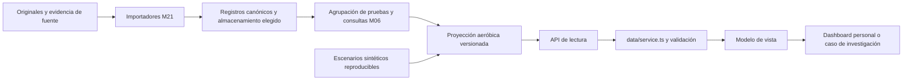

# Preparación del dashboard aeróbico para datos de main

Fecha: 15 de noviembre de 2026.
Estado: análisis y propuesta; no implementa integración ni modifica contratos.

Seguimiento: [entrega de frontend y pendientes de integración real](aerobic-data-integration-implementation.md).
El contenido de este análisis conserva la evidencia y el alcance de su inspección original.

## 1. Recomendación

Conservar el frontend actual como presentación y conectar una proyección de datos
que preserve la semántica del núcleo de `main`. La próxima mejora debe ser la
**fidelidad de los datos y de sus límites**, además de la apariencia sobria ya lograda.

Hay tres entregas distintas:

1. Seguimiento personal longitudinal con datos sintéticos identificados.
2. Exploración de una prueba real de investigación, con etapas y procedencia.
3. Seguimiento longitudinal real, cuando existan varias evaluaciones comparables
   del mismo participante y estén resueltas sus condiciones temporales y de medida.

La segunda entrega no demuestra la tercera. Los registros reales seleccionados
actualmente de MR080G permiten inspeccionar una prueba; no forman doce meses de
seguimiento de un astronauta.

## 2. Alcance verificado

Referencias locales inspeccionadas:

- `main`: `e5270c8d0d5c2ef7e54e6b166865e4764d2223c2`.
- `frontend`: `608dd3e36f74ecaa2cd5dff76b8131b4e0504701`.
- Los respectivos `origin/main` y `origin/frontend` apuntaban a esos mismos commits
  en las referencias locales. No se ejecutó fetch; no se afirma actualidad remota.
- La rama activa era `frontend`, con árbol limpio antes de crear este documento.

Se leyeron código, contratos, estado consolidado, manifiestos y órdenes de trabajo.
Se realizó una comprobación acotada del parser del frontend con un objeto ficticio
en memoria. No se ejecutaron importaciones, ensayos médicos, pipelines ni pruebas
completas de `main`. Los recuentos de importación corresponden a sus informes
versionados, contrastados con el código de selección.

En este workspace no existen `data/originals/` ni `data/local-import-profile/`.
Clonar el código no restaura el perfil IndexedDB ni los datos originales. No se
leyeron ni publicaron mediciones originales de participantes.

## 3. Qué ofrece cada rama

| Área | main | frontend actual | Implicación |
| --- | --- | --- | --- |
| Dominio | M01 valida registros, unidades desconocidas y relojes de origen | `Evaluation` contiene ID, fecha UTC, valor, unidad y método | Falta una proyección explícita entre ambos modelos |
| Identidad | Sujeto, estudio/procedencia y alcance del reloj | Astronautas de demostración | Los sujetos reales necesitan identidad separada y contextualizada |
| Ausencia | `recorded`, `confirmed_none`, `not_recorded` | Valor numérico o `null` | No convertir los tres estados en un único significado |
| Persistencia | Memoria e IndexedDB; correcciones mediante nuevos registros | Borradores y copia de revisión en localStorage | Diferentes responsabilidades y garantías |
| Datos sintéticos | M05 genera 16 registros; capacidad aeróbica sin resultado | Seis perfiles longitudinales con 13 visitas nominales | M05 no reemplaza por sí solo el historial aeróbico del dashboard |
| Datos reales | M21 importa perfiles concretos de CRF, adaptación y glucosa | Contrato 0.1 declara exclusivamente datos sintéticos | Activar `HEALTH_DATA_SOURCE=api` no habilita datos reales |
| Consultas | M06 sigue como placeholder | Filtrado, diferencias y pendiente descriptiva locales | Acordar quién produce las lecturas y su contrato |
| Presentación | M07/M09 y otras vistas pendientes | Dashboard Next.js implementado | La UI existente puede aprovechar el núcleo sin rehacerla por estética |
| Acceso | Shell HTTP de módulos y perfil local de desarrollo | API Node/TypeScript preliminar de lectura | main no expone directamente los endpoints del frontend |

La versión 0.8 del contrato de dominio de `main`, su esquema de registro 2 y el
contrato HTTP 0.1 del frontend son versiones de cosas distintas. No deben igualarse
cambiando un número ni suponerse compatibles.

`mock` frente a `api` solo define cómo se obtienen los datos. No determina si son
sintéticos, terrestres o de vuelo; la API preliminar también devuelve datos ficticios.
La procedencia debe viajar con cada resultado y con el contexto de la respuesta.

## 4. Lo que representa realmente MR080G hoy

El importador actual acepta únicamente un perfil verificado de Campaign 3C, una
persona, una fecha y una prueba de cicloergómetro concretas. Rechaza otros perfiles
MR080G para evitar transferir unidades no confirmadas.

Los informes de resolución vinculan cuatro filas con las etapas:

- `50 Watt Av.`
- `75 Watt Av.`
- `100 Watt Av.`
- `Peak AVG`

Cada fila produce ocho registros escalares: HR, VO₂ absoluto, VCO₂, RER,
VO₂ relativo a masa, VE, FEO₂ y FECO₂.

**4 etapas × 8 variables = 32 registros. Es una prueba, no 32 pruebas.**
Hay cuatro resultados de VO₂ relativo dentro de esa prueba; solo el asociado a
`Peak AVG` es candidato al resumen pico reportado por la fuente. Seleccionarlo
requiere un mapeo explícito de etapa y cantidad. No se debe tomar cada registro
como una visita, ni usar `Math.max` sobre columnas o etapas como definición de pico.

Unidades confirmadas para ese perfil: HR en bpm, VO₂/VCO₂ en L/min, VO₂ relativo
en mL/kg/min, VE en L/min con condición BTPS, RER adimensional y fracciones espiradas
en porcentaje. No se generalizan a todos los archivos de MR080G. Tampoco resuelven
las unidades de CRF o de otros estudios.

El importador conserva `Stage` dentro de `method`; no entrega todavía un objeto
estructurado de prueba con etapas. Tampoco convierte las etiquetas de potencia en
una serie temporal continua. El perfil de M21 no aporta por sí solo una señal
respiración a respiración ni toda la duración de la sesión.

### Diccionario mínimo de selección propuesto

| Campo importado | Contexto exigido | Cantidad de presentación candidata |
| --- | --- | --- |
| `aerobic_capacity` | Etapa verificada `Peak AVG` | VO₂pico relativo reportado |
| `VO2` | Misma prueba y etapa verificada `Peak AVG` | VO₂pico absoluto reportado |
| `aerobic_capacity` o `VO2` | Etapas de carga conocidas | VO₂ de esa etapa, no VO₂pico |
| `pulse` | Pico o etapa identificados | Frecuencia cardíaca del pico o de esa etapa |
| `VCO2`, `RER`, `VE`, `FEO2`, `FECO2` | Prueba y etapa conservadas | Cantidades técnicas originales, con sus unidades |

Este mapeo es una propuesta a revisar contra la fuente. No clasifica esfuerzo
máximo ni transforma VO₂pico en VO₂máx. No transfiere la unidad de `pulse` en MR080G
a `Pulse` de CRF.

### Límite temporal que sigue vigente

Estos registros usan `time: null` y `source_time` con precisión de día, zona
horaria desconocida y calendario `unknown`. La política actual de M01 bloquea
comparaciones cuando ese calendario sigue sin resolver.

Conocer el formato mes/día/año no prueba que la fecha sea un instante UTC ni que
el calendario no haya sido desplazado para anonimizarlo. Se puede mostrar la fecha
reportada y su incertidumbre; no añadir medianoche, `Z`, antigüedad exacta o una
alineación con la misión ficticia.

### Qué datos conviene priorizar

| Fuente | Utilidad aeróbica inicial | Límite actual |
| --- | --- | --- |
| MR080G seleccionado | Resultado pico reportado y tabla de etapas de una prueba | Una sola prueba; reloj incierto; perfil de importación restringido |
| Historial sintético del frontend | Recorrido de varios meses, faltantes y cambios de método | Ficticio, sin calibración fisiológica ni validación médica |
| ACTES | Candidato posterior para detalle de esfuerzo con eje relativo | Su adaptador y contrato de tiempo relativo no están implementados en M21 |
| CRF | Contexto de signos vitales o masa cuando sus unidades se resuelvan | No sustituye una prueba aeróbica; unidades seleccionadas aún desconocidas |
| MR079G / MR035G | Otras dimensiones de adaptación física | Fuerza y densidad ósea no equivalen a capacidad aeróbica |
| BUT CGM | Contexto metabólico de otra parte del producto | No aporta un VO₂pico ni una validación del desempeño aeróbico |

Los informes de `main` documentan 3861 registros importados entre cinco perfiles,
pero ese total no es un tamaño de muestra de evaluaciones aeróbicas. La existencia
del código o de un manifiesto no prueba que ese perfil local esté disponible aquí.

## 5. Brechas concretas del frontend

| Prioridad | Localización | Brecha y efecto |
| --- | --- | --- |
| P0 | `contracts/models.ts:2` | `dataKind` solo admite `synthetic`; no representa procedencia real |
| P0 | `contracts/models.ts:22` | `Evaluation` no identifica cantidad, persona, prueba, etapa ni registros fuente |
| P0 | `contracts/schemas.ts` | Fechas obligatoriamente ISO UTC y unidades no vacías impiden preservar incertidumbre de main |
| P0 | `contracts/schemas.ts` | Los objetos de evaluación eliminan campos adicionales no declarados |
| P0 | `data/service.ts:22` | `getMission` devuelve solo `response.data`; no transmite los metadatos de misión a la UI |
| P0 | `mission.ts:8` | Comparar unidad y método no verifica cantidad, identidad contextual, etapa, estado ni reloj |
| P0 | `aerobic.ts`, `review.ts` | CSV y revisión fijan origen sintético/texto de datos ficticios |
| P0 | `components/dashboard.tsx` | El encabezado y el pie afirman simulación sin consultar procedencia de la respuesta |
| P1 | `aerobic.ts:describePeriod` | Cuenta valores, no evaluaciones identificadas; recibir filas de etapas falsearía n |
| P1 | `dashboard-state.ts` | `Date.parse`, filtros y antigüedad asumen tiempo absoluto conocido |
| P1 | `components/aerobic-overview.tsx` | La etiqueta VO₂pico es fija, aunque el modelo no declara que el valor sea un pico |
| P1 | `review.ts` | La copia no conserva un manifiesto de fuentes ni versión de derivación |
| P1 | `components/trajectory-chart.tsx` | Cortar por método evita algunas mezclas, pero no diferencia todas las causas de no comparabilidad |

P0 significa resolver antes de habilitar datos reales. No indica gravedad médica.

### Comprobación del parser

Se pasó un objeto ficticio compatible con v0.1, añadiendo `origin`, `subjectRef`
y `sourceRecordIds` a una evaluación. El resultado de `missionResponseSchema.parse`
retuvo únicamente `id`, `recordedAt`, `value`, `unit` y `method`.
`originRetained` y `sourceRecordIdsRetained` fueron falsos.

Por tanto, un backend que simplemente añada metadatos a la respuesta actual puede
perderlos al atravesar el parser. La solución debe incluir contrato, esquema,
servicio y consumidores; no basta con ampliar un tipo TypeScript.

## 6. Qué significa seguir la capacidad o detectar un resultado inferior

Separar tres cuestiones:

1. **Resultado observado:** el valor es menor o mayor que una referencia comparable.
2. **Validez de la comparación:** misma persona contextualizada, cantidad, resultado
   pico/etapa, protocolo, unidad, base temporal y condiciones aceptadas.
3. **Interpretación de desempeño:** exige criterios de uso y revisión acordados.
   Una diferencia o pendiente no establece por sí sola «mal desempeño».

Texto inicial recomendado: «Resultado menor que la referencia seleccionada», junto
con diferencia, fechas, unidad y número de evaluaciones. Ante problemas de contexto:
«Comparación no evaluable: cambió el protocolo» o «Cronología de origen sin resolver».

No asignar «Estable», «Normal», «Apto» o «Riesgo» mediante tolerancias inventadas.
La ausencia de criterio se presenta como ausencia de criterio, no como resultado
favorable. M06 ya prevé `no_criterion` y `not_assessed`; todavía no los implementa.

### Métricas y uso propuesto

| Medida | Representación | Condición necesaria |
| --- | --- | --- |
| VO₂pico relativo, mL/kg/min | Indicador personal principal, si esa es la cantidad documentada | Pico reportado y normalización identificados |
| VO₂pico absoluto, L/min | Segundo gráfico o selector, con escala propia | Resultado absoluto de la misma prueba, no un valor submáximo cualquiera |
| Masa asociada, kg | Contexto de la normalización | Medida y unidad confirmadas, con vinculación temporal válida |
| HR por etapa / pico, bpm | Detalle del esfuerzo y condiciones de comparación | Misma etapa/carga y protocolo donde proceda |
| Carga/potencia, W | Contexto o resultado secundario cuando esté registrado | Valor explícito de la fuente; no inferir la potencia pico |
| RER y VE | Detalle técnico de la prueba | Unidad y condiciones conservadas; no puntuación automática de salud |
| Actividad completada | Registro independiente de sesiones | No tratar completar una sesión como demostrar mejora fisiológica |

VO₂ absoluto y relativo son cantidades distintas. Algebraicamente, un cambio de
masa puede modificar el cociente relativo sin que aumente el valor absoluto. No
calcular ese cociente con una masa de unidad desconocida o de otra visita.

La declaración [ARTP sobre CPET](https://pmc.ncbi.nlm.nih.gov/articles/PMC8593741/)
explica la importancia de modalidad, protocolo, calidad y esfuerzo para interpretar
una prueba; también advierte que RER aislado no es un indicador fiable de esfuerzo
máximo. Esto respalda conservar ese contexto. No se trasladan aquí sus criterios
clínicos, valores de referencia o instrucciones de ejecución a astronautas.

Un [resumen de investigación de NASA](https://ntrs.nasa.gov/citations/20140003748)
describe pruebas de ciclo antes, durante y después del vuelo y resultados modelados
para un sujeto promedio. Fundamenta la utilidad de observar fases y visitas; sus
cambios de grupo no son umbrales individuales ni curvas para copiar en la demo.

## 7. Arquitectura de integración recomendada

Mantener la frontera HTTP acordada con el responsable de backend:



M06 y la proyección del diagrama son trabajo pendiente. La API Node/TypeScript
actual es otra base preliminar; el servidor estático de `main` no la sustituye.
Los importadores puros pueden evaluarse para ejecución en Node; el store IndexedDB
y el perfil de Chromium no se vuelven legibles por un servidor Node por añadir un
endpoint. Hay que elegir y reconstruir una fuente de lectura reproducible.

Para el alcance inicial bastaría un repositorio de lectura de muestras verificadas,
con manifiesto de importación y pruebas de correspondencia. No hace falta comenzar
con sensores, streaming, autenticación avanzada o un sistema de sincronización.
Los originales no se exponen como carpeta pública del servidor.

La lógica de selección, agrupación, comparabilidad y criterios debe tener una
implementación de dominio acordada. La UI conserva formato, interacción y escalas
visuales. No duplicar gradualmente M06 dentro de cada componente React.

### Contrato de transporte

Proponer una nueva versión de lectura, por ejemplo `/api/v2/aerobic/...`, conservando
v1 para la demo mientras se coordina la migración. El nombre exacto está por acordar.
Las operaciones iniciales pueden limitarse a listar sujetos contextualizados,
listar sus evaluaciones y consultar el detalle de una prueba.

Separar versión HTTP, versión del dominio, versión de registro y versión de
proyección. La respuesta debe transportar procedencia y condiciones de reutilización
sin que el parser las descarte.

## 8. Modelo de presentación propuesto

No es un cambio aprobado del contrato compartido ni una implementación.

| Entidad | Campos necesarios |
| --- | --- |
| Sujeto | ID contextual; código original; dataset/release/cohorte; origen; etiqueta de presentación |
| Evaluación | ID estable; sujeto; fase del estudio o misión; prueba/protocolo; modalidad; estado de ejecución si se conoce |
| Tiempo | Variante UTC o fecha/datetime de fuente; precisión; calendario; zona; alcance del reloj; texto original |
| Resultado | Cantidad explícita; valor o ausencia; unidad conocida/desconocida; pico/etapa; reportado/medido/estimado cuando conste |
| Etapa | Identificador y etiqueta originales; orden verificado; carga o tiempo solo si están disponibles |
| Procedencia | Registros fuente; DOI/dataset/release; hash de archivo; fila/columna; perfil de importación; cita/licencia aplicables |
| Derivación | Regla y versión; IDs incluidos/excluidos; referencia; número de pruebas; período; motivo de bloqueo |
| Capacidades | Puede inspeccionarse, compararse, usar cronología, calcular antigüedad o tendencia; razones explícitas |

El sujeto se identifica por estudio/release/cohorte y código, no solo por el número
original. Nunca se reutiliza el ID de Vega para un participante real.
`source_time.scope` y `source` aportan evidencia, pero no conviene reconstruir toda
la identidad mediante parsing informal de strings en componentes.

El ensamblador de evaluaciones debe agrupar las variables y etapas de una misma
prueba sin confundir archivos complementarios con nuevas visitas. Su regla queda
versionada. El resultado pico conserva los IDs exactos usados para seleccionarlo.

La incertidumbre temporal y la de unidad son independientes. Tiempo relativo de
sesión puede ser una futura variante, pero ACTES no se habilita hasta definirla y
probarla: no se fuerza dentro del contrato UTC actual.

El consumidor debe comprobar que los `subjectRef` de las evaluaciones coincidan
con el sujeto solicitado. Hoy `getMeasurements` comprueba `astronautId`, mientras
que `getMission` no puede hacerlo porque sus evaluaciones carecen de identidad de
sujeto. El filtrado en el servidor y esta comprobación en la frontera se complementan.

No identificar «dato real» con «criterio clínico validado». Son dimensiones separadas:
procedencia, verificación técnica, calidad de medición y revisión de la interpretación.
No inventar metadatos de dispositivo o calidad que el archivo no declara.

## 9. Reglas antes de producir un cálculo

1. Validar estructura y versión; preservar los campos exigidos por el contrato.
2. Seleccionar sujeto contextual y estudio; comprobar origen y alcance de fuente.
3. Exigir resultado numérico disponible para cálculos; ausencia no es cero.
4. Comprobar cantidad: VO₂ relativo no es VO₂ absoluto, fracción espirada no es SpO₂,
   pulso durante una etapa no equivale a pulso de reposo.
5. Seleccionar la misma clase de resultado: pico con pico o etapa comparable con etapa.
6. Verificar unidad, modalidad y protocolo con la política acordada; un nombre parecido
   no prueba equivalencia y un string diferente puede necesitar revisión explícita.
7. Verificar la base temporal. Calendario desconocido bloquea el cálculo según main.
8. Aplicar exclusiones de calidad solo cuando existan condiciones y motivos documentados.
9. Calcular diferencia pareada o resumen del segmento elegible, conservando sus IDs.
10. Aplicar un criterio de desempeño únicamente si está configurado, es aplicable y
    conserva autor, fuente, versión y estado de revisión.

`main:app/core/index.js:areComparable` ya aporta comprobaciones de sujeto, variable,
unidad, método y reloj. Su comentario aclara que comparabilidad no prueba que haya
un valor disponible. No sustituye los pasos de disponibilidad, selección de pico ni
la identidad contextual del adaptador. No comprueba de forma independiente todos
los campos de origen/estudio/protocolo que proponemos para la proyección.

El «mínimo de tres» del frontend es una regla exploratoria de su demo, no una
justificación estadística. Con dos evaluaciones elegibles puede haber diferencia
pareada; con una no hay evolución. No calcular intervalos de confianza ficticios,
pronósticos o significación a partir de ese mínimo.

## 10. Mejoras de representación

### A. Seguimiento personal

Mantener la pantalla sobria actual y añadir contexto operativo:

```text
Seguimiento aeróbico              [Datos sintéticos / origen real identificado]
Persona / misión                 Fecha y base temporal disponibles

Cantidad: VO₂pico relativo       Protocolo / grupo comparable
Referencia elegida              Período efectivo

Último resultado | Cambio elegible | Evaluaciones válidas / disponibles

[Gráfico de evaluaciones]        [Detalle y procedencia de la prueba]
[Marcadores de fases conocidas]  [Condiciones y límites]

Resumen descriptivo y motivo de no evaluación, cuando corresponda
Tabla / registros excluidos / referencia / exportación con fuentes
```

Añadir selector de grupo comparable cuando el período incluya varios protocolos.
Conservar los resultados excluidos en tabla y explicar por qué no entraron, en lugar
de eliminarlos de la experiencia. No unir métodos ni convertir automáticamente
cinta y cicloergómetro en una única curva.

Cuando se confirme la masa asociada, ofrecer VO₂ absoluto y relativo en paneles
separados o mediante selector. Evitar dos ejes que sugieran relaciones por alineación
visual. Mantener referencia y rango de inspección perceptibles.

### B. Casos de investigación

Un espacio diferenciado del seguimiento del astronauta ficticio:

```text
Caso de investigación · análogo terrestre
Dataset / release / participante contextual / fase de bed rest
Fecha reportada: precisión día · calendario y zona sin confirmar

Pruebas disponibles: 1           Tendencia longitudinal: no evaluable

Resultado pico reportado         [Ficha de fuente y límites]
Tabla de etapas: 50 W | 75 W | 100 W | Peak AVG
Variables por etapa, cada una con su unidad
```

Para MR080G actual, empezar por la tabla de etapas y el pico reportado. Si se añade
un gráfico de etapas, usar puntos y eje categórico explícito; `Peak AVG` no recibe
una potencia o tiempo inventados. Este perfil descriptivo dentro de una prueba no
habilita las diferencias longitudinales que bloquea M01.

Cuatro etapas no son cuatro meses ni cuatro réplicas independientes. La UI debe
mostrar «1 prueba, 4 etapas, 32 registros fuente» cuando ese agrupamiento se haya
verificado, sin presentar n=32 como respaldo de una tendencia.

### C. Detalle y exportación

En el inspector: cantidad, valor/unidad, papel del resultado, protocolo, etapa,
base temporal, origen y acceso a la ficha de procedencia. Cita y límites no deben
quedar solo en «Acerca de».

En exportaciones: datos numéricos sin el redondeo de presentación, ausencia/estado,
calendario/precisión, fuente, unidad, método, IDs y versión de derivación. Diferenciar
la fecha de preparación del informe de la fecha de medida. Conservar las citas y
notices aplicables. Los comentarios clínicos excluidos por M21 siguen excluidos.

La precisión visual no es incertidumbre del instrumento. Una tarjeta puede redondear
si se declara y el detalle permite recuperar el valor original; no atribuir precisión
clínica al número de decimales mostrado.

## 11. Profesionalismo y referencia espacial

La principal mejora de seriedad será que el software explique exactamente qué sabe,
qué puede comparar y qué conserva. Mantener tipografía legible, cifras alineadas,
nombres estables, estados visibles, tabla accesible, temas consistentes y navegación
sin perder contexto. El color distingue selección, origen o estado del dato con
texto/símbolo redundante; no convierte una pendiente en un semáforo clínico.

NASA-STD-3001 Vol. 2, revisión F, §§10.4.2.1–10.4.2.4, trata presentación simultánea de
información crítica, redundancia del color, unidades y legibilidad. Es una referencia
de diseño; no certifica la aplicación. La criticidad, dispositivo, distancia de
lectura e iluminación deben evaluarse para un uso real.

Fuentes: [ficha oficial de la norma](https://standards.nasa.gov/node/237),
[revisión F](https://standards.nasa.gov/system/files/tmp/NASA-STD-3001%20Vol%202%20Rev%20F.pdf).

Conservar la simulación como tal también es rigor profesional. No declarar sensores
en vivo, sincronización, persistencia segura o aptitud médica que no existen.
El borrador local actual no equivale a un expediente clínico auditado.

## 12. Preparación de los escenarios sintéticos

Reutilizar los seis perfiles actuales, proyectados al mismo modelo de vista que los
casos reales. Añadir casos de contrato antes de ampliar las curvas:

- Una prueba única con cuatro etapas y un pico identificable.
- Calendario desconocido; fecha de día sin zona; unidad desconocida.
- Dos protocolos que generan segmentos distintos.
- Última visita sin resultado y último valor válido antiguo.
- Dos sujetos con el mismo código original en estudios distintos.
- Mismo número con distinta cantidad o unidad.
- Cambio de masa con VO₂ absoluto sin aumento, en datos íntegramente ficticios.
- Ningún criterio de desempeño configurado y criterio marcado solo como demo.

Cada escenario conserva identidad sintética, valores reproducibles y su propósito.
No trasladar las fechas reales a 2026 ni asignar datos reales a una persona ficticia.
No usar efectos medios de estudios como tasas esperadas de recuperación individual.
Si se simulan varias magnitudes relacionadas, documentar sus relaciones para que
las tarjetas no se contradigan; eso no demuestra realismo fisiológico.

## 13. Orden de implementación y reparto

| Paso | Entrega concreta | Responsable principal | Resultado de aceptación |
| --- | --- | --- | --- |
| 1 | Diccionario de cantidad/pico/etapa y selección MR080G | Datos/backend, con revisión de dominio | Los 32 registros producen una prueba; no hay tendencia ficticia |
| 2 | Propuesta versionada de respuesta aeróbica y fixtures | Acuerdo frontend/backend | Origen, tiempo y fuente sobreviven parser y exportación |
| 3 | Proyector de mocks al nuevo modelo de vista | Frontend | Los seis escenarios continúan funcionando sin depender de main en el navegador |
| 4 | Lectura reproducible de la muestra real | Backend | Fuente restaurada y hash verificado; ninguna lectura de IndexedDB supuesta |
| 5 | Consultas/agrupación y proyección de dominio | Backend/M06 según arquitectura acordada | Misma respuesta para gráfico, tabla y resumen; exclusiones explicadas |
| 6 | Vista de investigación y capacidades condicionadas | Frontend | MR080G se inspecciona con sus límites; fechas y cálculos no se inventan |
| 7 | Nuevas pruebas reales longitudinales | Datos/backend | Identidad, protocolo y calendario permiten comparación antes de habilitarla |

No modificar `contracts/` unilateralmente. Coordinar modelos, Zod, OpenAPI, ejemplos
y tests de compatibilidad en una entrega revisable. Backend implementa importación,
repositorio y endpoints; frontend consume `data/service.ts`, normaliza presentación
y mantiene sus componentes sin acceso a rutas de originales.

Antes de integrar ramas, resolver decisiones de arquitectura y lenguaje: main tiene
una aplicación modular sin transpilación, políticas de dependencias y una norma de
repositorio en inglés; frontend usa Next.js/TypeScript y textos en español bajo su
propia configuración. La propuesta aquí preserva el frontend autorizado y añade una
frontera de lectura; no implica que un merge directo resuelva esas diferencias ni
que las instrucciones contradictorias puedan ignorarse.

La serialización de dominio de main no debe reducirse a v1 perdiendo evidencia, ni
el frontend debe importar el store de navegador como si fuera un backend HTTP.
No hace falta cambiar de framework para demostrar un recorrido correcto.

## 14. Pruebas que deberían preceder a la integración real

| Caso | Resultado esperado |
| --- | --- |
| Muestra MR080G seleccionada | Una evaluación, etapas conservadas, un pico reportado; n de pruebas=1 |
| Registros de la misma fecha con variables diferentes | No aparecen como visitas independientes de VO₂pico |
| Pico frente a etapa de 75 W | Diferencia longitudinal bloqueada |
| Misma persona/código en estudios diferentes | No se agrupa como un único astronauta |
| Calendario `unknown` | Fecha fuente visible; sin edad UTC ni tendencia temporal |
| Dos unidades desconocidas | No se consideran comparables por coincidir en desconocimiento |
| Cambio de método o normalización | Segmentos y motivo; sin salto interpretado como avance |
| `not_recorded` o `confirmed_none` en cantidad numérica | No entra como cero ni como valor válido |
| Dato real en un endpoint de simulación | Error de contexto; no se reasigna al sujeto sintético |
| Origen o IDs fuente adicionales en transporte | Se conservan según contrato o se rechaza versión; no se pierden silenciosamente |
| Exportación de una prueba real | Sin etiqueta sintética fija; cita y estado temporal preservados |
| Fuente modificada o importación repetida | Custodia/deduplicación comprobadas; no duplica una evaluación |
| Revisión preparada tras cambiar regla o fuente | La copia conserva el contexto anterior y puede identificarse la diferencia |
| Dataset ausente en otra máquina | Estado explícito y pasos de restauración; sin reemplazo por mocks |

Las pruebas visuales deben comprobar teclado, color redundante, texto ampliado y
la posibilidad de comprobar cada resumen con sus registros. No basta un screenshot.

## 15. Decisiones pendientes de dominio

Para la médica y el responsable de datos: qué cantidad seguir, cómo se identifica
un pico aceptado, qué condiciones hacen comparables las pruebas, qué referencia
usar, qué variación impide concluir estabilidad y qué criterio de desempeño puede
mostrarse. La calidad o esfuerzo insuficiente debe proceder de una regla revisada o
del registro de la prueba, no de un juicio inventado por el dashboard.

Mientras se acuerdan esos puntos se puede implementar toda la preservación de
procedencia, el detalle real de una prueba y los bloqueos de cálculo. Esa es la
siguiente entrega más útil para frontend y backend.

## Evidencia local consultada

En main, mediante `git show e5270c8:<ruta>`:

- `docs/CURRENT_STATUS.md`, `docs/modules.csv`, `docs/CONTRACTS.md`.
- `app/core/index.js:89`, `app/importers/index.js:18–86`, `app/readings/index.js`.
- `app/contracts/data.js`, `app/contracts/interfaces.js`, `app/scenario/index.js`.
- `docs/DATA_TECHNICAL_RESOLUTION.md`, `docs/SOURCE_PAPER_UNITS.md`.
- `docs/data/unit-dictionary-followup-2026-11-15.json`.
- `docs/data/real-import-validation-2026-11-15.json`, `docs/experiments/REAL_IMPORT.md`.
- `docs/DATA_IMPORT_PREPARATION.md`, órdenes M06 y M09, instrucciones de colaboración.

En frontend: contratos y esquemas, servicio/API, helpers de comparación, filtros y
escala, mocks, revisión, gráfico, inspector y configuración del dashboard.

Se aplicaron criterios de documentación, UI/UX y selección de gráficos. La consulta
inicial de la base de charts devolvió opciones ajenas al caso; se refinó a series
temporales. No se adoptaron sus sugerencias de pronóstico, smoothing o umbrales de
anomalía. Modern Web Guidance se consultó para la tabla accesible; no se implementaron
cambios en componentes durante esta investigación.
