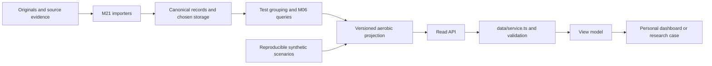

# Preparing the aerobic dashboard for data from main

Date: November 15, 2026.
Status: analysis and proposal; it does not implement integration nor modify contracts.

Follow-up: [frontend delivery and pending items for real integration](aerobic-data-integration-implementation.md).
The content of this analysis keeps the evidence and the scope of its original inspection.

## 1. Recommendation

Keep the current frontend as the presentation layer and connect a data projection
that preserves the semantics of the `main` core. The next improvement must be the
**fidelity of the data and of their limits**, in addition to the sober appearance already achieved.

There are three distinct deliveries:

1. Longitudinal personal follow-up with identified synthetic data.
2. Exploration of a real research test, with stages and provenance.
3. Real longitudinal follow-up, once several comparable assessments
   of the same participant exist and their time and measurement conditions are resolved.

The second delivery does not demonstrate the third. The real records currently selected
from MR080G allow inspecting one test; they do not form twelve months of
follow-up of an astronaut.

## 2. Verified scope

Local references inspected:

- `main`: `e5270c8d0d5c2ef7e54e6b166865e4764d2223c2`.
- `frontend`: `608dd3e36f74ecaa2cd5dff76b8131b4e0504701`.
- The respective `origin/main` and `origin/frontend` pointed to those same commits
  in the local references. No fetch was run; remote currency is not claimed.
- The active branch was `frontend`, with a clean tree before creating this document.

Code, contracts, consolidated status, manifests and work orders were read.
A bounded check of the frontend parser was done with a fictional in-memory
object. No imports, medical trials, pipelines or full tests of
`main` were run. The import counts correspond to its versioned
reports, checked against the selection code.

In this workspace `data/originals/` and `data/local-import-profile/` do not exist.
Cloning the code does not restore the IndexedDB profile or the original data. No
original participant measurements were read or published.

## 3. What each branch offers

| Area | main | current frontend | Implication |
| --- | --- | --- | --- |
| Domain | M01 validates records, unknown units and source clocks | `Evaluation` contains ID, UTC date, value, unit and method | An explicit projection between both models is missing |
| Identity | Subject, study/provenance and clock scope | Demonstration astronauts | Real subjects need separate and contextualized identity |
| Absence | `recorded`, `confirmed_none`, `not_recorded` | Numeric value or `null` | Do not collapse the three states into a single meaning |
| Persistence | Memory and IndexedDB; corrections through new records | Drafts and review copy in localStorage | Different responsibilities and guarantees |
| Synthetic data | M05 generates 16 records; aerobic capacity without result | Six longitudinal profiles with 13 nominal visits | M05 does not by itself replace the dashboard's aerobic history |
| Real data | M21 imports specific profiles of CRF, adaptation and glucose | Contract 0.1 declares exclusively synthetic data | Enabling `HEALTH_DATA_SOURCE=api` does not enable real data |
| Queries | M06 remains a placeholder | Local filtering, differences and descriptive slope | Agree on who produces the readings and their contract |
| Presentation | M07/M09 and other views pending | Next.js dashboard implemented | The existing UI can leverage the core without redoing it for aesthetics |
| Access | HTTP module shell and local development profile | Preliminary read Node/TypeScript API | main does not directly expose the frontend's endpoints |

Version 0.8 of the `main` domain contract, its record schema 2 and the frontend's
HTTP contract 0.1 are versions of different things. They must not be equated
by changing a number nor assumed to be compatible.

`mock` versus `api` only defines how the data are obtained. It does not determine whether they are
synthetic, ground or flight; the preliminary API also returns fictional data.
Provenance must travel with each result and with the context of the response.

## 4. What MR080G actually represents today

The current importer accepts only one verified profile of Campaign 3C, one
person, one date and one specific cycle ergometer test. It rejects other MR080G
profiles to avoid transferring unconfirmed units.

The resolution reports link four rows to the stages:

- `50 Watt Av.`
- `75 Watt Av.`
- `100 Watt Av.`
- `Peak AVG`

Each row produces eight scalar records: HR, absolute VO₂, VCO₂, RER,
mass-relative VO₂, VE, FEO₂ and FECO₂.

**4 stages × 8 variables = 32 records. It is one test, not 32 tests.**
There are four relative VO₂ results within that test; only the one associated with
`Peak AVG` is a candidate for the peak summary reported by the source. Selecting it
requires an explicit mapping of stage and quantity. Each record must not be taken
as a visit, nor use `Math.max` over columns or stages as the definition of peak.

Confirmed units for that profile: HR in bpm, VO₂/VCO₂ in L/min, relative VO₂
in mL/kg/min, VE in L/min with BTPS condition, RER dimensionless and expired fractions
in percent. They are not generalized to all MR080G files. Nor do they resolve
the units of CRF or other studies.

The importer keeps `Stage` inside `method`; it does not yet deliver a structured
test object with stages. Nor does it convert the power labels into a continuous
time series. The M21 profile does not by itself provide a breath-by-breath signal or the full duration of the session.

### Proposed minimum selection dictionary

| Imported field | Required context | Candidate presentation quantity |
| --- | --- | --- |
| `aerobic_capacity` | Verified stage `Peak AVG` | Reported relative peak VO₂ |
| `VO2` | Same test and verified stage `Peak AVG` | Reported absolute peak VO₂ |
| `aerobic_capacity` or `VO2` | Known load stages | VO₂ of that stage, not peak VO₂ |
| `pulse` | Identified peak or stage | Heart rate at the peak or at that stage |
| `VCO2`, `RER`, `VE`, `FEO2`, `FECO2` | Test and stage preserved | Original technical quantities, with their units |

This mapping is a proposal to be reviewed against the source. It does not classify maximal
effort nor turn peak VO₂ into VO₂max. It does not transfer the unit of `pulse` in MR080G
to `Pulse` in CRF.

### Time limit that remains in force

These records use `time: null` and `source_time` with day precision, unknown
time zone and `unknown` calendar. The current M01 policy blocks
comparisons while that calendar remains unresolved.

Knowing the month/day/year format does not prove that the date is a UTC instant nor that
the calendar has not been shifted to anonymize it. The reported date and its
uncertainty can be shown; do not add midnight, `Z`, exact age or an
alignment with the fictional mission.

### Which data to prioritize

| Source | Initial aerobic usefulness | Current limit |
| --- | --- | --- |
| Selected MR080G | Reported peak result and stage table of one test | A single test; uncertain clock; restricted import profile |
| Frontend synthetic history | Multi-month journey, missing values and method changes | Fictional, without physiological calibration or medical validation |
| ACTES | Later candidate for effort detail with relative axis | Its adapter and relative-time contract are not implemented in M21 |
| CRF | Context of vital signs or mass when its units are resolved | It does not replace an aerobic test; selected units still unknown |
| MR079G / MR035G | Other dimensions of physical adaptation | Strength and bone density are not equivalent to aerobic capacity |
| BUT CGM | Metabolic context of another part of the product | It provides neither a peak VO₂ nor a validation of aerobic performance |

The `main` reports document 3861 records imported across five profiles,
but that total is not a sample size of aerobic assessments. The existence
of the code or a manifest does not prove that this local profile is available here.

## 5. Concrete frontend gaps

| Priority | Location | Gap and effect |
| --- | --- | --- |
| P0 | `contracts/models.ts:2` | `dataKind` only admits `synthetic`; it does not represent real provenance |
| P0 | `contracts/models.ts:22` | `Evaluation` does not identify quantity, person, test, stage or source records |
| P0 | `contracts/schemas.ts` | Mandatory ISO UTC dates and non-empty units prevent preserving main's uncertainty |
| P0 | `contracts/schemas.ts` | Evaluation objects strip additional undeclared fields |
| P0 | `data/service.ts:22` | `getMission` returns only `response.data`; it does not transmit the mission metadata to the UI |
| P0 | `mission.ts:8` | Comparing unit and method does not verify quantity, contextual identity, stage, state or clock |
| P0 | `aerobic.ts`, `review.ts` | CSV and review fix the synthetic origin/fictional data text |
| P0 | `components/dashboard.tsx` | The header and footer claim simulation without consulting the provenance of the response |
| P1 | `aerobic.ts:describePeriod` | Counts values, not identified assessments; receiving stage rows would falsify n |
| P1 | `dashboard-state.ts` | `Date.parse`, filters and age assume known absolute time |
| P1 | `components/aerobic-overview.tsx` | The peak VO₂ label is fixed, although the model does not declare that the value is a peak |
| P1 | `review.ts` | The copy does not keep a source manifest or derivation version |
| P1 | `components/trajectory-chart.tsx` | Cutting by method avoids some mixes, but does not differentiate all causes of non-comparability |

P0 means resolve before enabling real data. It does not indicate medical severity.

### Parser check

A fictional object compatible with v0.1 was passed, adding `origin`, `subjectRef`
and `sourceRecordIds` to an assessment. The result of `missionResponseSchema.parse`
retained only `id`, `recordedAt`, `value`, `unit` and `method`.
`originRetained` and `sourceRecordIdsRetained` were false.

Therefore, a backend that simply adds metadata to the current response may
lose it when passing through the parser. The solution must include contract, schema,
service and consumers; extending a TypeScript type is not enough.

## 6. What it means to follow capacity or detect a lower result

Separate three questions:

1. **Observed result:** the value is lower or higher than a comparable reference.
2. **Validity of the comparison:** same contextualized person, quantity, peak/stage
   result, protocol, unit, time basis and accepted conditions.
3. **Interpretation of performance:** requires agreed criteria of use and review.
   A difference or slope does not by itself establish «poor performance».

Recommended initial text: «Result lower than the selected reference», together
with difference, dates, unit and number of assessments. For context problems:
«Comparison not assessable: protocol changed» or «Source chronology unresolved».

Do not assign «Stable», «Normal», «Fit» or «Risk» through invented tolerances.
The absence of a criterion is presented as absence of a criterion, not as a favorable
result. M06 already foresees `no_criterion` and `not_assessed`; it does not implement them yet.

### Metrics and proposed use

| Measure | Representation | Necessary condition |
| --- | --- | --- |
| Relative peak VO₂, mL/kg/min | Main personal indicator, if that is the documented quantity | Reported peak and normalization identified |
| Absolute peak VO₂, L/min | Second chart or selector, with its own scale | Absolute result of the same test, not any submaximal value |
| Associated mass, kg | Context of the normalization | Measure and unit confirmed, with valid time linkage |
| HR by stage / peak, bpm | Effort detail and comparison conditions | Same stage/load and protocol where applicable |
| Load/power, W | Context or secondary result when recorded | Explicit value from the source; do not infer the peak power |
| RER and VE | Technical detail of the test | Unit and conditions preserved; no automatic health score |
| Completed activity | Independent record of sessions | Do not treat completing a session as demonstrating physiological improvement |

Absolute and relative VO₂ are distinct quantities. Algebraically, a change in
mass can modify the relative quotient without the absolute value increasing. Do not
calculate that quotient with a mass of unknown unit or from another visit.

The [ARTP statement on CPET](https://pmc.ncbi.nlm.nih.gov/articles/PMC8593741/)
explains the importance of modality, protocol, quality and effort for interpreting
a test; it also warns that RER alone is not a reliable indicator of maximal
effort. This supports preserving that context. Its clinical criteria, reference values
or execution instructions are not transferred here to astronauts.

A [NASA research summary](https://ntrs.nasa.gov/citations/20140003748)
describes cycle tests before, during and after flight and results modeled
for an average subject. It grounds the usefulness of observing phases and visits; its
group changes are not individual thresholds nor curves to copy in the demo.

## 7. Recommended integration architecture

Keep the HTTP boundary agreed with the backend owner:



M06 and the projection in the diagram are pending work. The current Node/TypeScript
API is another preliminary base; main's static server does not replace it.
The pure importers can be evaluated for execution in Node; the IndexedDB store
and the Chromium profile do not become readable by a Node server by adding an
endpoint. A reproducible read source must be chosen and rebuilt.

For the initial scope, a read repository of verified samples would suffice,
with an import manifest and correspondence tests. There is no need to start
with sensors, streaming, advanced authentication or a sync system.
The originals are not exposed as a public server folder.

The selection, grouping, comparability and criteria logic must have an agreed
domain implementation. The UI keeps format, interaction and visual scales.
Do not gradually duplicate M06 inside each React component.

### Transport contract

Propose a new read version, for example `/api/v2/aerobic/...`, keeping
v1 for the demo while the migration is coordinated. The exact name is yet to be agreed.
The initial operations can be limited to listing contextualized subjects,
listing their assessments and querying the detail of a test.

Separate HTTP version, domain version, record version and
projection version. The response must carry provenance and reuse conditions
without the parser discarding them.

## 8. Proposed presentation model

It is not an approved change to the shared contract nor an implementation.

| Entity | Necessary fields |
| --- | --- |
| Subject | Contextual ID; original code; dataset/release/cohort; origin; presentation label |
| Assessment | Stable ID; subject; study or mission phase; test/protocol; modality; execution state if known |
| Time | UTC variant or source date/datetime; precision; calendar; zone; clock scope; original text |
| Result | Explicit quantity; value or absence; known/unknown unit; peak/stage; reported/measured/estimated when recorded |
| Stage | Original identifier and label; verified order; load or time only if available |
| Provenance | Source records; DOI/dataset/release; file hash; row/column; import profile; applicable citation/license |
| Derivation | Rule and version; included/excluded IDs; reference; number of tests; period; block reason |
| Capabilities | Can be inspected, compared, use chronology, compute age or trend; explicit reasons |

The subject is identified by study/release/cohort and code, not just by the original
number. The ID of Vega is never reused for a real participant.
`source_time.scope` and `source` provide evidence, but it is not advisable to rebuild the entire
identity through informal string parsing in components.

The assessment assembler must group the variables and stages of the same
test without confusing complementary files with new visits. Its rule is
versioned. The peak result keeps the exact IDs used to select it.

Time uncertainty and unit uncertainty are independent. Relative session
time can be a future variant, but ACTES is not enabled until it is defined and
tested: it is not forced into the current UTC contract.

The consumer must check that the `subjectRef` of the assessments matches
the requested subject. Today `getMeasurements` checks `astronautId`, while
`getMission` cannot do so because its assessments lack subject identity.
Server-side filtering and this check at the boundary complement each other.

Do not equate «real data» with «validated clinical criterion». They are separate dimensions:
provenance, technical verification, measurement quality and review of the interpretation.
Do not invent device or quality metadata that the file does not declare.

## 9. Rules before producing a calculation

1. Validate structure and version; preserve the fields required by the contract.
2. Select contextual subject and study; check origin and source scope.
3. Require an available numeric result for calculations; absence is not zero.
4. Check quantity: relative VO₂ is not absolute VO₂, expired fraction is not SpO₂,
   pulse during a stage is not equivalent to resting pulse.
5. Select the same class of result: peak with peak or comparable stage with stage.
6. Verify unit, modality and protocol with the agreed policy; a similar name
   does not prove equivalence and a different string may need explicit review.
7. Verify the time basis. Unknown calendar blocks the calculation per main.
8. Apply quality exclusions only when documented conditions and reasons exist.
9. Calculate paired difference or summary of the eligible segment, preserving its IDs.
10. Apply a performance criterion only if it is configured, applicable and
    preserves author, source, version and review status.

`main:app/core/index.js:areComparable` already provides checks for subject, variable,
unit, method and clock. Its comment clarifies that comparability does not prove that a
value is available. It does not replace the availability steps, peak selection or
the adapter's contextual identity. It does not independently check all
the origin/study/protocol fields we propose for the projection.

The frontend's «minimum of three» is an exploratory rule of its demo, not a
statistical justification. With two eligible assessments there can be a paired
difference; with one there is no evolution. Do not calculate fictitious confidence intervals,
forecasts or significance from that minimum.

## 10. Representation improvements

### A. Personal follow-up

Keep the current sober screen and add operational context:

```text
Aerobic follow-up                [Synthetic data / identified real origin]
Person / mission                 Date and time basis available

Quantity: relative peak VO₂      Protocol / comparable group
Chosen reference                 Effective period

Latest result | Eligible change | Valid / available assessments

[Assessment chart]               [Test detail and provenance]
[Known phase markers]            [Conditions and limits]

Descriptive summary and reason for non-assessment, when applicable
Table / excluded records / reference / export with sources
```

Add a comparable-group selector when the period includes several protocols.
Keep excluded results in the table and explain why they were not included, instead
of removing them from the experience. Do not join methods nor automatically convert
treadmill and cycle ergometer into a single curve.

When the associated mass is confirmed, offer absolute and relative VO₂ in separate
panels or through a selector. Avoid two axes that suggest relationships through visual
alignment. Keep reference and inspection range perceptible.

### B. Research cases

A space differentiated from the fictional astronaut's follow-up:

```text
Research case · ground analog
Dataset / release / contextual participant / bed rest phase
Reported date: day precision · calendar and zone unconfirmed

Tests available: 1               Longitudinal trend: not assessable

Reported peak result             [Source card and limits]
Stage table: 50 W | 75 W | 100 W | Peak AVG
Variables per stage, each with its unit
```

For the current MR080G, start with the stage table and the reported peak. If a
stage chart is added, use points and an explicit categorical axis; `Peak AVG` does not receive
an invented power or time. This descriptive profile within a test does not
enable the longitudinal differences that M01 blocks.

Four stages are not four months nor four independent replicates. The UI must
show «1 test, 4 stages, 32 source records» when that grouping has been
verified, without presenting n=32 as support for a trend.

### C. Detail and export

In the inspector: quantity, value/unit, role of the result, protocol, stage,
time basis, origin and access to the provenance card. Citation and limits must not
remain only in «About».

In exports: numeric data without presentation rounding, absence/state,
calendar/precision, source, unit, method, IDs and derivation version. Differentiate
the report preparation date from the measurement date. Keep applicable citations and
notices. Clinical comments excluded by M21 remain excluded.

Visual precision is not instrument uncertainty. A card may round
if declared and the detail allows recovering the original value; do not attribute clinical
precision to the number of decimals shown.

## 11. Professionalism and spatial reference

The main improvement in seriousness will be for the software to explain exactly what it knows,
what it can compare and what it preserves. Keep legible typography, aligned figures,
stable names, visible states, accessible table, consistent themes and navigation
without losing context. Color distinguishes selection, origin or data state with
redundant text/symbol; it does not turn a slope into a clinical traffic light.

NASA-STD-3001 Vol. 2, revision F, §§10.4.2.1–10.4.2.4, addresses simultaneous presentation of
critical information, color redundancy, units and legibility. It is a design
reference; it does not certify the application. Criticality, device, reading
distance and lighting must be evaluated for real use.

Sources: [official record of the standard](https://standards.nasa.gov/node/237),
[revision F](https://standards.nasa.gov/system/files/tmp/NASA-STD-3001%20Vol%202%20Rev%20F.pdf).

Keeping the simulation as such is also professional rigor. Do not declare live
sensors, synchronization, secure persistence or medical suitability that do not exist.
The current local draft is not equivalent to an audited clinical record.

## 12. Preparing the synthetic scenarios

Reuse the six current profiles, projected to the same view model as the
real cases. Add contract cases before extending the curves:

- A single test with four stages and an identifiable peak.
- Unknown calendar; day-level date without zone; unknown unit.
- Two protocols that generate distinct segments.
- Last visit without a result and an old last valid value.
- Two subjects with the same original code in different studies.
- Same number with a different quantity or unit.
- Mass change with absolute VO₂ not increasing, in entirely fictional data.
- No performance criterion configured and a criterion marked only as demo.

Each scenario keeps synthetic identity, reproducible values and its purpose.
Do not move real dates to 2026 nor assign real data to a fictional person.
Do not use mean effects of studies as expected individual recovery rates.
If several related magnitudes are simulated, document their relationships so that
the cards do not contradict each other; that does not demonstrate physiological realism.

## 13. Implementation order and distribution

| Step | Concrete delivery | Main owner | Acceptance result |
| --- | --- | --- | --- |
| 1 | Dictionary of quantity/peak/stage and MR080G selection | Data/backend, with domain review | The 32 records produce one test; there is no fictitious trend |
| 2 | Versioned aerobic response proposal and fixtures | Frontend/backend agreement | Origin, time and source survive parser and export |
| 3 | Projector from mocks to the new view model | Frontend | The six scenarios keep working without depending on main in the browser |
| 4 | Reproducible reading of the real sample | Backend | Source restored and hash verified; no IndexedDB reading assumed |
| 5 | Queries/grouping and domain projection | Backend/M06 according to agreed architecture | Same response for chart, table and summary; exclusions explained |
| 6 | Research view and conditioned capabilities | Frontend | MR080G is inspected with its limits; dates and calculations are not invented |
| 7 | New real longitudinal tests | Data/backend | Identity, protocol and calendar allow comparison before enabling it |

Do not modify `contracts/` unilaterally. Coordinate models, Zod, OpenAPI, examples
and compatibility tests in a reviewable delivery. Backend implements import,
repository and endpoints; frontend consumes `data/service.ts`, normalizes presentation
and keeps its components without access to original paths.

Before integrating branches, resolve architecture and language decisions: main has
a modular application without transpilation, dependency policies and a repository
rule of English; frontend uses Next.js/TypeScript and Spanish texts under its
own configuration. The proposal here preserves the authorized frontend and adds a
read boundary; it does not imply that a direct merge resolves those differences nor
that the contradictory instructions can be ignored.

The domain serialization of main must not be reduced to v1 losing evidence, nor
should the frontend import the browser store as if it were an HTTP backend.
There is no need to change framework to demonstrate a correct journey.

## 14. Tests that should precede real integration

| Case | Expected result |
| --- | --- |
| Selected MR080G sample | One assessment, stages preserved, one reported peak; number of tests=1 |
| Records of the same date with different variables | They do not appear as independent peak VO₂ visits |
| Peak versus 75 W stage | Longitudinal difference blocked |
| Same person/code in different studies | Not grouped as a single astronaut |
| `unknown` calendar | Source date visible; no UTC age or time trend |
| Two unknown units | Not considered comparable for coinciding in being unknown |
| Method or normalization change | Segments and reason; no jump interpreted as progress |
| `not_recorded` or `confirmed_none` in a numeric quantity | Does not enter as zero nor as a valid value |
| Real data in a simulation endpoint | Context error; not reassigned to the synthetic subject |
| Additional origin or source IDs in transport | Preserved per contract or version rejected; not silently lost |
| Export of a real test | No fixed synthetic label; citation and time state preserved |
| Modified source or repeated import | Custody/deduplication verified; does not duplicate an assessment |
| Review prepared after changing rule or source | The copy keeps the previous context and the difference can be identified |
| Dataset absent on another machine | Explicit state and restoration steps; no replacement by mocks |

Visual tests must check keyboard, redundant color, enlarged text and
the ability to verify each summary against its records. A screenshot is not enough.

## 15. Pending domain decisions

For the physician and the data owner: which quantity to follow, how an accepted
peak is identified, what conditions make tests comparable, which reference to
use, what variation prevents concluding stability and what performance criterion can be
shown. Insufficient quality or effort must come from a reviewed rule or from
the test record, not from a judgment invented by the dashboard.

While those points are agreed, all the provenance preservation,
the real detail of a test and the calculation blocks can be implemented. That is the
most useful next delivery for frontend and backend.

## Local evidence consulted

In main, through `git show e5270c8:<path>`:

- `docs/CURRENT_STATUS.md`, `docs/modules.csv`, `docs/CONTRACTS.md`.
- `app/core/index.js:89`, `app/importers/index.js:18–86`, `app/readings/index.js`.
- `app/contracts/data.js`, `app/contracts/interfaces.js`, `app/scenario/index.js`.
- `docs/DATA_TECHNICAL_RESOLUTION.md`, `docs/SOURCE_PAPER_UNITS.md`.
- `docs/data/unit-dictionary-followup-2026-11-15.json`.
- `docs/data/real-import-validation-2026-11-15.json`, `docs/experiments/REAL_IMPORT.md`.
- `docs/DATA_IMPORT_PREPARATION.md`, M06 and M09 work orders, collaboration instructions.

In frontend: contracts and schemas, service/API, comparison helpers, filters and
scale, mocks, review, chart, inspector and dashboard configuration.

Documentation, UI/UX and chart selection criteria were applied. The initial
query of the charts database returned options unrelated to the case; it was refined to time
series. Its suggestions of forecasting, smoothing or anomaly
thresholds were not adopted. Modern Web Guidance was consulted for the accessible table; no
changes to components were implemented during this research.
